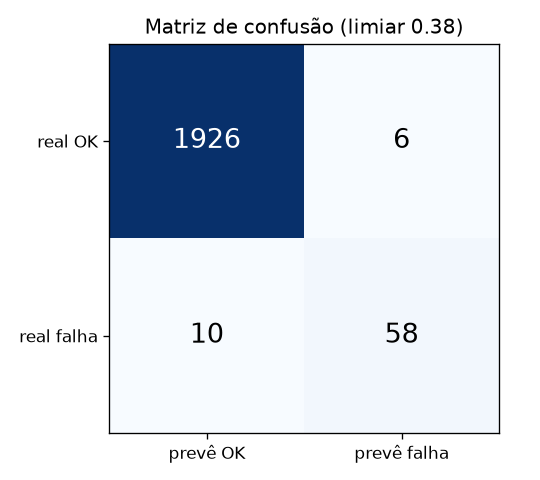
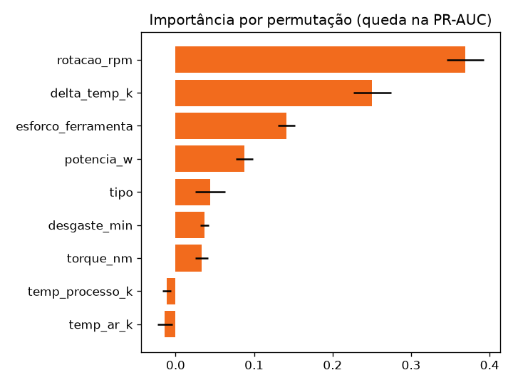

# Previsão de Falhas em Máquinas Industriais


Modelo de **manutenção preditiva**: a partir das leituras de sensores de uma fresadora (temperaturas, rotação, torque e desgaste da ferramenta), ele prevê se a operação vai terminar em falha. Assim a máquina pode ser parada para manutenção **antes** da quebra.

O projeto vai da análise exploratória até uma **API que serve o modelo treinado**.

## Resultado

No conjunto de teste (2.000 operações que o modelo nunca viu):

| Métrica | Valor | |
|---|---|---|
| **Recall** | **85%** | antecipou 58 das 68 falhas |
| **Precisão** | **91%** | só 6 alarmes falsos em 1.932 operações normais |
| PR-AUC | 0,88 | um palpite aleatório daria 0,034 |
| ROC-AUC | 0,98 | |

| Matriz de confusão | Importância das features |
|---|---|
|  |  |

As métricas completas estão em [`relatorio/metricas.json`](relatorio/metricas.json), e a análise passo a passo no notebook [`notebooks/analise.ipynb`](notebooks/analise.ipynb).

## Decisões importantes

**1. Vazamento de dados.** O dataset tem colunas que dizem **qual** falha aconteceu (desgaste, calor, potência, sobrecarga). Elas só existem depois da falha, então usá-las seria dar a resposta ao modelo. Essas colunas ficam de fora, e há um teste que garante isso.

**2. Features da física da máquina.** Criei três variáveis a partir dos mecanismos de falha, e elas ficaram entre as mais importantes do modelo:

| Feature | Fórmula | Por quê |
|---|---|---|
| `potencia_w` | torque × rotação × 2π/60 | falha com potência muito baixa ou muito alta |
| `delta_temp_k` | T processo − T ar | o calor não dissipa quando a diferença é pequena |
| `esforco_ferramenta` | desgaste × torque | ferramenta gasta trabalhando com força |

**3. Métrica certa para classe rara.** Só 3,4% das operações falham. Um modelo que sempre diz "não vai falhar" teria 96,6% de acurácia e seria inútil. Por isso a comparação usa a **PR-AUC** (área sob a curva precisão-recall).

**4. Comparação justa.** A regressão logística, a random forest e o gradient boosting são comparados em **validação cruzada estratificada de 5 dobras**, só com os dados de treino. O teste é usado uma única vez, no final.

| Modelo | PR-AUC (validação cruzada) |
|---|---|
| Random forest | **0,893** |
| Gradient boosting | 0,884 |
| Regressão logística | 0,455 |

**5. Limiar de decisão pelo custo.** Deixar passar uma falha (parada não planejada) custa mais que um alarme falso (uma inspeção). O limiar não fica no padrão de 0,5: ele é escolhido para maximizar o **F2**, que dá ao recall o dobro do peso da precisão. Com isso, o limiar ficou em 0,38.

## API

```bash
python -m falhas.treinar          # treina, salva o modelo e gera o relatório
flask --app falhas.api run        # sobe a API em http://localhost:5000
```

```bash
curl -X POST localhost:5000/prever -H "Content-Type: application/json" -d '{
  "tipo": "L", "temp_ar_k": 300.5, "temp_processo_k": 310.2,
  "rotacao_rpm": 1300, "torque_nm": 68.0, "desgaste_min": 215
}'
```

```json
{ "falha_prevista": true, "probabilidade_falha": 0.9933, "risco": "alto" }
```

- `POST /prever` aceita uma leitura ou uma lista de leituras, e valida tipos e faixas com Pydantic (erros de leitura voltam como 400)
- `GET /modelo` informa qual modelo está em uso, o limiar e as métricas de teste

**Com Docker** (o modelo é treinado no build):

```bash
docker build -t previsao-falhas .
docker run -p 8000:8000 previsao-falhas
```

## Estrutura

```text
dados/ai4i2020.csv      dataset (CC BY 4.0, créditos em dados/LEIAME.md)
falhas/dados.py         leitura, limpeza e features físicas
falhas/modelo.py        candidatos, validação cruzada, limiar F2 e métricas
falhas/treinar.py       treino completo, gráficos e metricas.json
falhas/api.py           API Flask
notebooks/analise.ipynb análise exploratória e modelagem comentadas
tests/                  18 testes (dados, modelo e API)
```

## Testes

```bash
pip install -e ".[dev]"
pytest
```

Os testes verificam:
- a ausência de vazamento de dados
- o cálculo das features
- a escolha do limiar num caso conhecido
- as métricas
- que o modelo é muito melhor que o acaso
- as respostas da API, inclusive as validações

O CI roda lint, testes, um treino completo e o build da imagem Docker.

## Créditos do dataset

[AI4I 2020 Predictive Maintenance Dataset](https://archive.ics.uci.edu/dataset/601), de Stephan Matzka, publicado no UCI Machine Learning Repository sob a licença [CC BY 4.0](https://creativecommons.org/licenses/by/4.0/). O dataset é sintético e reproduz dados reais de manutenção preditiva da indústria.

---

<details>
<summary>English</summary>

### Machine Failure Prediction

Predictive maintenance on the AI4I 2020 dataset with **scikit-learn**, from EDA to a **Flask API** serving the model.

- Leakage-free features (failure-type columns removed) plus physics-based features (power, temperature delta, tool strain)
- Logistic regression vs. random forest vs. gradient boosting in stratified 5-fold CV, selected by **PR-AUC** (3.4% positive class)
- Decision threshold tuned for **F2** (missing a failure costs more than a false alarm)
- Test set: **85% recall, 91% precision**, PR-AUC 0.88 (random baseline 0.034)
- Pydantic-validated API, Docker image that trains at build time, 18 tests and CI

</details>
